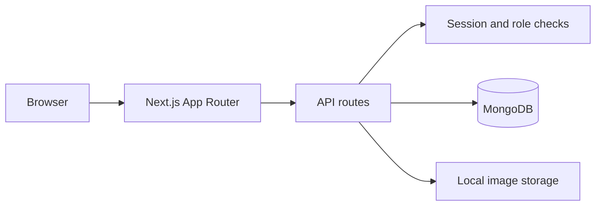

# Coffee Shop Management System

A full-stack coffee-shop management **development project** featuring administration and point-of-sale (POS) workflows.

> **Status:** Development/portfolio project. Production readiness and security have not been independently validated.

## Features

- Management of categories, products, sizes, toppings and orders.
- Staff POS flow for creating orders, tickets and invoices.
- Role-oriented management and POS pages, account sign-in, and audit-log views.

## Stack

**Next.js 16 · React 19 · TypeScript · Tailwind CSS 4 · MongoDB · jose · bcryptjs**

## Architecture



*This diagram describes the implementation layout, not independently verified security controls.*

## Local development

Requirements: Node.js compatible with project dependencies, npm, and MongoDB.

```bash
git clone https://github.com/VoDinhHoangAnh/Cofee-Shop-Management-System.git
cd Cofee-Shop-Management-System
npm ci
```

Create `.env.local` from the example and configure a **disposable local database**:

```dotenv
DATABASE_URL=mongodb://127.0.0.1:27017/coffee-management
```

For first-time local demo data only:

```bash
npm run seed
```

**WARNING — destructive:** `scripts/seed-mongo.ts` deletes documents from application collections (including users, orders and audit logs) before reseeding. Never use it on a database with valuable data. Seeded credentials are demo-only and must not be used for Internet-facing deployments.

Start the application:

```bash
npm run dev
```

Open http://localhost:3000.

## Quality checks

The project defines these scripts; passing outcomes have not been independently confirmed:

```bash
npm run lint
npm run typecheck
npm run build
```

## Key directories

| Location | Role |
| --- | --- |
| `src/app/` | UI and API routes |
| `src/lib/` | Reusable infrastructure and authentication utilities |
| `scripts/seed-mongo.ts` | **Destructive demo-data initializer** |
| `public/img/` | Product-image storage |
| `.env.example` | Example environment settings |

## Security and engineering limitations

- Demo accounts and seeded passwords are **not production credentials**.
- Authorization, input validation, image uploads, session management and payment-related workflows need an independent security review before real use.
- Local file-based image storage needs an explicit deployment/storage design.
- Automated test coverage, anonymized screenshots and a reviewed role/permission matrix remain documentation/improvement goals.

**Scope:** Software engineering portfolio and controlled local demonstration. Not an audited production POS/payment system.
