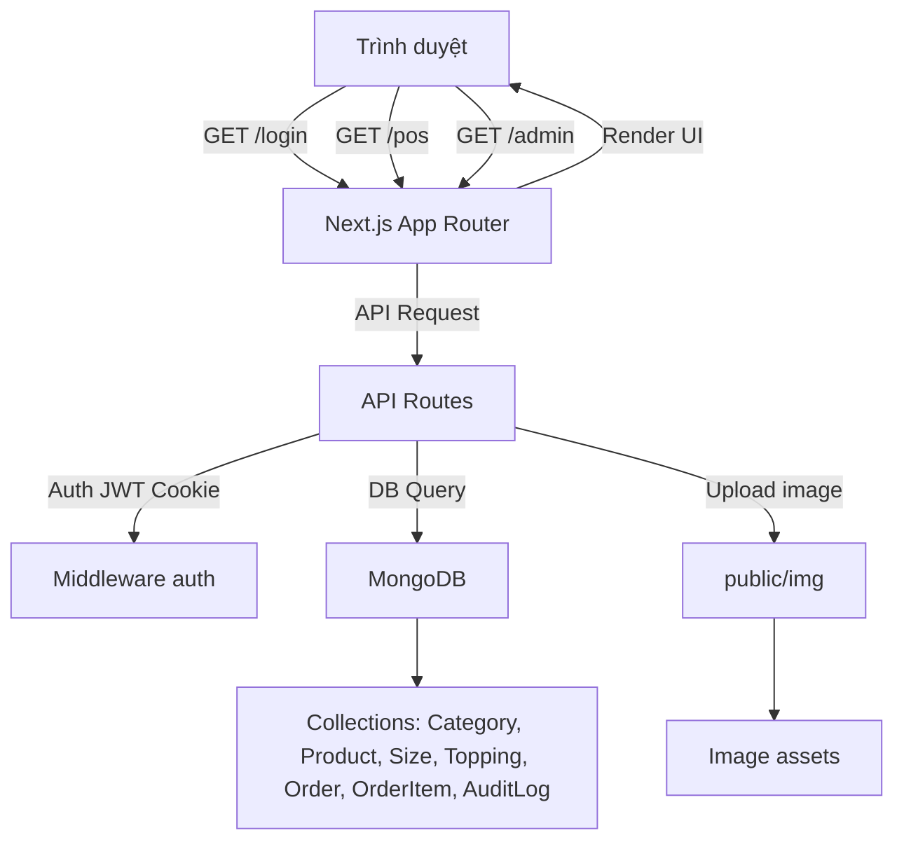

This is a [Next.js](https://nextjs.org) project bootstrapped with [`create-next-app`](https://nextjs.org/docs/app/api-reference/cli/create-next-app).

## Getting Started

Cài đặt thư viện (nếu chưa làm):
npm install

Nạp dữ liệu mẫu (Quan trọng: Để có tài khoản đăng nhập và menu ban đầu):
npm run seed

First, run the development server:

```bash
npm run dev
# or
yarn dev
# or
pnpm dev
# or
bun dev
```

Đăng nhập quyền Quản lý (Admin)

- Username : admin
- Password : admin123

Đăng nhập quyền Nhân viên (Staff)

- Username : staff
- Password : staff123

Open [http://localhost:3000](http://localhost:3000) with your browser to see the result.

## Tổng quan hệ thống

Hệ thống quản lý quán cafe này gồm hai luồng chính:

- `Admin`: quản lý danh mục, sản phẩm, topping, đơn hàng, nhật ký và upload ảnh sản phẩm.
- `POS`: giao diện nhân viên để chọn món, bổ sung topping/size, tạo đơn và in ticket/hóa đơn.

### Kiến trúc



### Cách hoạt động chính

1. Người dùng truy cập trang và đăng nhập.
2. `middleware.ts` kiểm tra JWT cookie `session` để xác thực truy cập vào `dashboard`, `pos`, `admin` và các API cần bảo vệ.
3. Phiên làm việc được lưu bằng JWT (HS256) trong cookie, tạo/giải mã bằng `src/lib/auth.ts`.
4. Dữ liệu menu được tải qua `/api/pos/menu`:
   - đọc `Category` và `Product` từ MongoDB
   - lookup `Size` cho mỗi sản phẩm
   - trả về đường dẫn ảnh trực tiếp nếu có giá trị `image` (tự động lưu trong `public/img`).
5. Admin upload ảnh qua `/api/admin/upload`:
   - đọc file từ form upload
   - lưu file vào `public/img`
   - trả về URL công khai như `/img/xxxx.jpg`
6. Admin tạo/sửa sản phẩm, danh mục, topping qua các API `src/app/api/admin/*`.
7. POS tạo đơn hàng qua `/api/pos/orders`, sau đó có thể in ticket/hóa đơn và thanh toán.

### Thành phần công nghệ

- `Next.js 16` với App Router
- `React 19`
- `TypeScript`
- `Tailwind CSS 4`
- `MongoDB` với `mongodb` Node.js driver
- `jose` để tạo và xác thực JWT
- `bcryptjs` cho băm mật khẩu (dùng trong seed và auth)
- `dotenv` để đọc biến môi trường
- `tsx` để chạy file seed script
- `lucide-react` cho icon UI

### Luồng dữ liệu chính

- `src/app/middleware.ts`: bảo vệ route bằng cookie JWT
- `src/lib/mongodb.ts`: kết nối MongoDB
- `src/lib/auth.ts`: mã hóa và giải mã session
- `src/app/api/admin/upload/route.ts`: upload file ảnh vào `public/img`
- `src/app/api/pos/menu/route.ts`: trả dữ liệu menu cho POS

## Cấu trúc Project

Dưới đây là cấu trúc cây thư mục và file của project, cùng với giải thích tác vụ của từng file/folder:

```
he_thong_quan_ly_quan_cafe/
├── AGENTS.md                             # Tài liệu về các agent (có thể là hướng dẫn cho AI hoặc công cụ)
├── CLAUDE.md                             # Tài liệu liên quan đến Claude (có thể là hướng dẫn hoặc cấu hình)
├── eslint.config.mjs                     # Cấu hình ESLint cho kiểm tra lỗi code JavaScript/TypeScript
├── next-env.d.ts                         # File khai báo TypeScript cho Next.js
├── next.config.ts                        # Cấu hình Next.js
├── package.json                          # Quản lý dependencies và scripts của project
├── postcss.config.mjs                    # Cấu hình PostCSS cho xử lý CSS
├── README.md                             # Tài liệu hướng dẫn project (file này)
├── tsconfig.json                         # Cấu hình TypeScript
├── image_archive/                        # Thư mục lưu trữ ảnh dự phòng
├── public/                               # Thư mục tĩnh công khai
│   └── img/                              # Thư mục chứa hình ảnh sản phẩm được upload
├── scripts/                              # Thư mục chứa các script tiện ích
│   └── seed-mongo.ts                     # Script để nạp dữ liệu mẫu vào MongoDB
└── src/                                  # Thư mục nguồn chính
    ├── middleware.ts                     # Middleware Next.js để xác thực JWT
    ├── app/                              # Thư mục App Router của Next.js
    │   ├── globals.css                   # CSS toàn cục
    │   ├── layout.tsx                    # Layout gốc của ứng dụng
    │   ├── page.tsx                      # Trang chủ
    │   ├── admin/                        # Khu vực Admin
    │   │   ├── layout.tsx                # Layout cho Admin
    │   │   ├── page.tsx                  # Trang dashboard Admin
    │   │   ├── logs/                     # Quản lý nhật ký
    │   │   │   └── page.tsx              # Trang xem nhật ký hệ thống
    │   │   ├── menu/                     # Quản lý menu
    │   │   │   └── page.tsx              # Trang quản lý menu (sản phẩm, danh mục)
    │   │   └── orders/                   # Quản lý đơn hàng
    │   │       └── page.tsx              # Trang xem và quản lý đơn hàng
    │   ├── api/                          # API Routes
    │   │   ├── admin/                    # API cho Admin
    │   │   │   ├── categories/           # API quản lý danh mục
    │   │   │   │   └── route.ts          # CRUD danh mục
    │   │   │   ├── logs/                 # API nhật ký
    │   │   │   │   └── route.ts          # Lấy nhật ký hệ thống
    │   │   │   ├── orders/               # API đơn hàng Admin
    │   │   │   │   └── route.ts          # Quản lý đơn hàng từ Admin
    │   │   │   ├── products/             # API sản phẩm
    │   │   │   │   └── route.ts          # CRUD sản phẩm
    │   │   │   ├── toppings/             # API topping
    │   │   │   │   └── route.ts          # CRUD topping
    │   │   │   └── upload/               # API upload ảnh
    │   │   │       └── route.ts          # Upload file ảnh sản phẩm
    │   │   ├── auth/                     # API xác thực
    │   │   │   ├── login/                # API đăng nhập
    │   │   │   │   └── route.ts          # Xử lý đăng nhập
    │   │   │   ├── logout/               # API đăng xuất
    │   │   │   │   └── route.ts          # Xử lý đăng xuất
    │   │   │   └── session/              # API session
    │   │   │       └── route.ts          # Kiểm tra session hiện tại
    │   │   └── pos/                      # API cho POS
    │   │       ├── menu/                 # API menu POS
    │   │       │   └── route.ts          # Lấy dữ liệu menu cho POS
    │   │       └── orders/               # API đơn hàng POS
    │   │           ├── route.ts          # Tạo đơn hàng mới
    │   │           └── [id]/             # API cho đơn hàng cụ thể
    │   │               ├── invoice/      # API hóa đơn
    │   │               │   └── route.ts  # Lấy dữ liệu hóa đơn
    │   │               ├── pay/          # API thanh toán
    │   │               │   └── route.ts  # Xử lý thanh toán
    │   │               └── ticket/       # API ticket
    │   │                   └── route.ts  # Lấy dữ liệu ticket
    │   ├── dashboard/                    # Trang dashboard chung
    │   │   └── page.tsx                  # Trang dashboard sau đăng nhập
    │   ├── login/                        # Trang đăng nhập
    │   │   └── page.tsx                  # Form đăng nhập
    │   └── pos/                          # Khu vực POS
    │       ├── page.tsx                  # Trang chính POS
    │       └── orders/                   # Quản lý đơn hàng POS
    │           └── [id]/                 # Chi tiết đơn hàng
    │               ├── invoice/          # Trang hóa đơn
    │               │   └── page.tsx      # Hiển thị hóa đơn
    │               └── ticket/           # Trang ticket
    │                   └── page.tsx      # Hiển thị ticket
    └── lib/                              # Thư viện tiện ích
        ├── auth.ts                       # Hàm mã hóa/giải mã JWT và xác thực
        └── mongodb.ts                    # Kết nối và cấu hình MongoDB
```

You can start editing the page by modifying `app/page.tsx`. The page auto-updates as you edit the file.

This project uses [`next/font`](https://nextjs.org/docs/app/building-your-application/optimizing/fonts) to automatically optimize and load [Geist](https://vercel.com/font), a new font family for Vercel.

## Learn More

To learn more about Next.js, take a look at the following resources:

- [Next.js Documentation](https://nextjs.org/docs) - learn about Next.js features and API.
- [Learn Next.js](https://nextjs.org/learn) - an interactive Next.js tutorial.

You can check out [the Next.js GitHub repository](https://github.com/vercel/next.js) - your feedback and contributions are welcome!

## Deploy on Vercel

The easiest way to deploy your Next.js app is to use the [Vercel Platform](https://vercel.com/new?utm_medium=default-template&filter=next.js&utm_source=create-next-app&utm_campaign=create-next-app-readme) from the creators of Next.js.

Check out our [Next.js deployment documentation](https://nextjs.org/docs/app/building-your-application/deploying) for more details.

QR thanh toan bang ngan hang
https://img.vietqr.io/image/vcb-1041472221-compact2.jpg?amount=1000&addInfo=ban05&accountName=NGUYENDUCHAO
